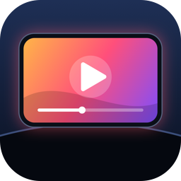
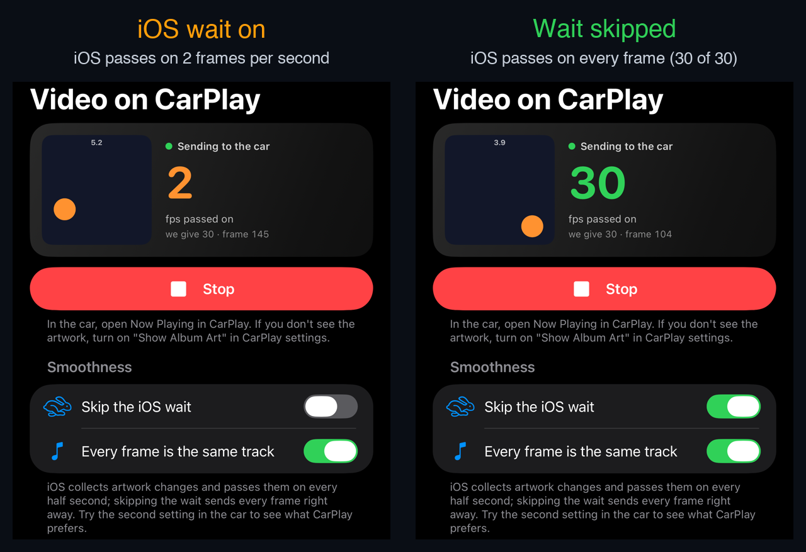

<p align="center"></p>

<h1 align="center">Video on CarPlay</h1>

<p align="center"><b>Put your own pictures and video on the CarPlay screen, without Apple's CarPlay approval.</b><br>
Frame by frame, through the Now Playing artwork.</p>

An app needs an entitlement from Apple to have its own icon and screen in CarPlay, and iOS checks it on the
iPhone. But any app that plays audio becomes the "now playing" app, and CarPlay shows its title, artist and
**artwork** on the Now Playing screen. **Video on CarPlay** changes that artwork up to 60 times a second, so the
artwork becomes a picture that moves: a test pattern, an animation, or a video from your Photos or a link, with
the video's sound coming from the car's speakers. The car's ⏮ ⏯ ⏭ buttons come back to the app as commands.

The app UI is available in **English and Turkish** (globe menu, top right).

> [!WARNING]
> **Do not watch video while driving.** Use it only while parked, or for a passenger, and follow the law
> where you are. The app does not know whether the car is moving and does not stop on its own.

---

## Contents
1. [What it does and doesn't do](#1-what-it-does-and-doesnt-do)
2. [Why it used to be choppy: iOS sends 2 artworks per second](#2-why-it-used-to-be-choppy-ios-sends-2-artworks-per-second)
3. [Install](#3-install)
4. [Using it in the car](#4-using-it-in-the-car)
5. [Settings](#5-settings)
6. [How it works](#6-how-it-works)
7. [Other ways to get video into a car](#7-other-ways-to-get-video-into-a-car)
8. [Credits and license](#8-credits-and-license)

---

## 1. What it does and doesn't do

**Does:**
- Plays audio so that iOS treats it as the now playing app, and sends a new artwork image for every frame
  (1 to 60 frames per second).
- Sources: a **counter pattern** (to count how many frames really arrive), a **bouncing ball** (to judge
  smoothness), **video** and the phone's **camera** live.
- Video from **Photos**, from a direct **mp4 or m3u8 link**, or from a **YouTube link**. The sound plays from the
  car's speakers; the progress bar on Now Playing shows the real position and you can seek from it.
- Shows two numbers on the phone: the frames per second **we give** and the frames per second **iOS really passes
  on** (how often iOS asks for the artwork image).
- Car buttons: ⏭ raises the speed, ⏮ switches the source, ⏯ pauses or resumes.

**Doesn't:**
- It is not real CarPlay video. The picture is the artwork box on the Now Playing screen; its size and position
  are decided by CarPlay (in our car a square on the left).
- It cannot show the screen of another app. When the YouTube app plays, YouTube becomes the now playing app and
  CarPlay shows YouTube's own artwork.
- Other audio (radio, Spotify) stops while it runs: only a non-mixable audio session gets onto Now Playing.
- It is not for the App Store: it uses a private field of iOS (see [section 2](#2-why-it-used-to-be-choppy-ios-sends-2-artworks-per-second)).
  You build it and install it on your own iPhone.

**Tested so far:**
- iPhone 13 Pro Max, iOS 27.0.1: with the wait skipped iOS passes on **30 of 30** frames per second, without it **2**.
  The lock screen's Now Playing shows the app's artwork too.
- In a car with wireless CarPlay: the video plays on Now Playing frame by frame. At 24 fps it was clean; at 30
  and 60 fps the car now and then showed its empty placeholder artwork for a moment. The speeds in between
  (25, 27, 29) and the smaller artwork sizes are there to find the car's limit.

## 2. Why it used to be choppy: iOS sends 2 artworks per second

The first versions sent 15 or 30 artworks per second, but the car showed something like a slide show. Measured
in the simulator by watching iOS's media service (`mediaremoted`): whether the app sent 4, 8, 30 or 60 artworks a
second, **only 2 per second reached it**. `MPNowPlayingInfoCenter` collects updates and passes them on at most
every half second.

It keeps the time of the last push in a private ivar, `_pushDate`. Moving that date into the past right before
each update makes every update go out immediately: 30 of 30, 60 of 60 in the simulator, and 30 of 30 on an
iPhone. This is the **Skip the iOS wait** switch, and it is the whole trick
([NowPlayingPush.swift](VideoOnCarPlay/Sources/NowPlayingPush.swift)):

```swift
// Called right before each nowPlayingInfo assignment
guard let queue = center.value(forKey: "accessQueue") as? DispatchQueue else { return }
queue.sync { center.setValue(Date.distantPast, forKey: "pushDate") }
center.nowPlayingInfo = info
```

<p align="center"></p>

Because the field is private, the app first checks that it exists. If a future iOS renames it, the switch is
disabled and the app falls back to about 2 frames per second instead of crashing.

Two more things that matter:
- **A constant content identifier** (`MPNowPlayingInfoPropertyExternalContentIdentifier`). Without it every
  update is a new track for iOS (a new item identifier every frame). With it, every frame is new artwork of the
  same track. Both can be chosen in the app (**Every frame is the same track**), to compare in the car.
- **A constant title.** CarPlay throttles title changes separately, so the title does not change per frame; the
  frame number is drawn into the picture instead.
- **Send `MPNowPlayingInfoPropertyIsLiveStream` every time.** If it was ever `true` (for example while a video was
  still opening), leaving the key out later did not clear it, and the car kept showing LIVE for a normal video.
  Now it is always sent, `false` unless the source really is live (the camera).

## 3. Install

**Requirements:** a Mac with Xcode, [XcodeGen](https://github.com/yonaskolb/XcodeGen) (`brew install xcodegen`),
an iPhone with iOS 17 or later and an Apple ID. Free Apple IDs can sign it too; apps signed that way stop opening
after 7 days and need to be installed again.

```bash
git clone https://github.com/Burak4Arslan/video-on-carplay.git
cd video-on-carplay
cp Config/local.env.example Config/local.env   # optional: your Team ID and a bundle ID of your own
./generate.sh
open VideoOnCarPlay.xcodeproj
```

In Xcode pick your iPhone and press **Run**. Without `Config/local.env` choose your team in
*Signing & Capabilities* and change the bundle ID to something unique.

## 4. Using it in the car

1. Connect the iPhone to CarPlay, open **Video on CarPlay** on the phone and press **Start sending to the car**.
2. In CarPlay open **Now Playing**. If you don't see the artwork, open the **Settings** app on the car's CarPlay
   screen and turn on **Show Album Art**.
3. Start with the **Counter** source at 30 fps: the number in the car should count up smoothly, and the white
   bar at the bottom moves one step per frame, so skipped frames show up as gaps.
4. For video: **Pick a video from Photos** or paste a link and press **Open**.
5. The car's ⏭ ⏮ ⏯ buttons change the speed, the source and pause; every press shows up in the **Log**.

## 5. Settings

| Setting | What it does |
| --- | --- |
| **Skip the iOS wait** | Sends every frame right away (see section 2). Off: about 2 frames per second. |
| **Every frame is the same track** | Keeps a constant content identifier. Off: every frame is a new track. |
| **Source** | Counter, Ball or Video. |
| **Artwork size** | 600, 450 or 300 px. Smaller images are less to carry to the car. |
| **Speed** | 1 to 60 frames per second, with 20, 24, 25, 27 and 29 in between. |
| **Camera** | Back or front camera, live. iOS only allows the camera while the app is on screen, so the phone stays awake. |
| **Method** (video) | **Frame by frame**: the artwork trick. **Animated artwork**: iOS 26's `MPMediaItemAnimatedArtwork`; the app cuts up to 2 minutes of the video into square and portrait clips and the system plays them by itself. In our car this looked worse than frame by frame. |
| **Fill the square** | Crops a 16:9 video to a square from the center, since CarPlay shows the artwork as a square. |
| **Audible test tone** | Plays a quiet 440 Hz tone instead of silence, to hear that the audio is running. |

YouTube links are opened with [YouTubeKit](https://github.com/alexeichhorn/YouTubeKit), only on the device
(its remote server is off): the stream URLs are found, the 480p video and the audio are downloaded in 8 MB
ranges and played locally. Streaming them directly was tried and was much slower. YouTube's terms do not allow
access outside its own player, so treat this as a personal experiment; it can break whenever YouTube changes.

## 6. How it works

| File | |
| --- | --- |
| [CarScreen.swift](VideoOnCarPlay/Sources/CarScreen.swift) | The audio session, the frame timer, building `nowPlayingInfo`, the car's buttons, the frame counters. |
| [NowPlayingPush.swift](VideoOnCarPlay/Sources/NowPlayingPush.swift) | Skipping the half-second wait; counting the frames iOS really asks for. |
| [VideoPlayback.swift](VideoOnCarPlay/Sources/VideoPlayback.swift) | `AVPlayer` with sound plus `AVPlayerItemVideoOutput` for frames (scaled down, turned to the right orientation, cropped and drawn off the main thread). |
| [Frames.swift](VideoOnCarPlay/Sources/Frames.swift) | The counter pattern and the bouncing ball. |
| [CameraCapture.swift](VideoOnCarPlay/Sources/CameraCapture.swift) | The live camera source. |
| [AnimatedArtwork.swift](VideoOnCarPlay/Sources/AnimatedArtwork.swift) | iOS 26 animated artwork clips. |
| [YouTubeLoader.swift](VideoOnCarPlay/Sources/YouTubeLoader.swift) | YouTube links (YouTubeKit, ranged downloads, combining video and audio). |
| [CarPlayView.swift](VideoOnCarPlay/Sources/CarPlayView.swift) | The phone screen. |

Details worth knowing if you build something similar:
- The frames come from a `DispatchSourceTimer`, not `CADisplayLink`: they go to the car, not to the phone's
  display, and the timer keeps running in the background.
- Video frames are requested from the player already scaled down (short side 600 px) and are sent as soon as
  they are rendered. At 1080p only 18–21 of 25 frames per second made it in the simulator; scaled, 24–25.
- Videos shot in portrait are stored in landscape; the player's frames have to be turned using the track's
  `preferredTransform`.
- If the player stops giving frames (iOS may switch the video track off while the phone is locked), a local file
  is read at the current time with `AVAssetImageGenerator` instead, rendered on the CPU.
- The phone's own preview updates at most 10 times a second; redrawing SwiftUI every frame loaded the main thread.

## 7. Other ways to get video into a car

- **The official way:** a CarPlay entitlement from Apple. iOS 27 adds a video category, but such apps need the
  entitlement, only work while parked, and only appear if the car supports it
  ([WWDC26 "Rev up your CarPlay app"](https://developer.apple.com/videos/play/wwdc2026/212/)).
- **Navigation apps** draw their own base view, but Apple's rules allow only a map there.
- **A CarPlay AI box:** an Android device that plugs into the car's USB port and presents itself as an iPhone;
  needs a car with wired CarPlay.
- **Widgets and Live Activities** show on the CarPlay Dashboard since iOS 26 without a CarPlay app, but they are
  not video.

## 8. Credits and license

- [YouTubeKit](https://github.com/alexeichhorn/YouTubeKit) by Alexander Eichhorn (MIT) for YouTube links.
- Built with [XcodeGen](https://github.com/yonaskolb/XcodeGen).

Video on CarPlay is released under the [MIT License](LICENSE). It is not affiliated with Apple. CarPlay is a
trademark of Apple Inc.
